<!--
  hey, you're reading the source. respect.
  this file is generated from my website's content — scripts/github-readme.mjs
-->

<p align="center">
  
</p>

<p align="center">
  <a href="https://github.com/praveen-exe"></a>
  <a href="https://www.linkedin.com/in/praveen-saravanakumar-417557437/"></a>
  <a href="https://leetcode.com/u/Wxt9kWCH20/"></a>
  <a href="https://codeforces.com/profile/praveen.23"></a>
  <a href="https://www.hackerrank.com/profile/PES2UG26AM283"></a>
</p>

<p align="center">
  
</p>

<p align="center"><sub><code>7,268</code> bits of me. they're not random — read them row by row as 8‑bit ASCII.</sub></p>

### `~/neofetch`

```yaml
praveen@universe:
  os: "PortfolioOS 2026 (du-sh 1.0)"
  host: "BTech Computer Science (AI&ML) @ PES University"
  location: "Bengaluru, India"
  role: "Student · Developer · Creative Technologist"
  stack: "Python, ScikitLearn"
  learning: "ML, focused on SciKitLearn and Hugging Face"
  building: "Buidling webpages, dashboards"
  interests: "AI, Web Development, Design, Startups, Hackathons"
  mode: "a proffessional procastinator"
  status: "Open to interesting projects"
```

### `~/about.md`

> My journey into technology started with simple ***curiosity*** — wanting to understand how things work and what I could create with them.
>
> Today, I’m exploring **Artificial Intelligence**, **Machine Learning**, and **Cybersecurity**, while constantly learning, experimenting, and building along the way. I enjoy solving problems, trying new ideas, and turning what I learn into something meaningful.
>
> For me, technology isn’t just about using what already exists — it’s about ***understanding, creating, and pushing*** what’s possible.
>

### `~/stack`

<code>programming languages</code>&nbsp;


<code>ai &amp; machine learning</code>&nbsp;


<code>learning now</code>&nbsp; ML, focused on SciKitLearn and Hugging Face

<code>interests</code>&nbsp; `ai` · `web development` · `design` · `startups` · `hackathons`

### `~/journey`

```text
$ git log --graph --reverse-chronological journey

* 5bf1c22 (HEAD -> main)
|   2026-09      hackathon  Breakthrough 1.0 @ IEEE PESU Student Branch
|
* f584886
|   2026 → now   education  BTech Computer Science (AI&ML) @ PES University
|
* 2c198a3
|   2024 → 2026  education  Higher Secondary Education @ BASE PU College
|
* e3bebd7
|   2010 → 2024  education  Primary & Secondary Education @ St. Paul's English School
*  (root) curiosity.exe
```

### `~/activity`

<picture>
  <source media="(prefers-color-scheme: dark)" srcset="https://raw.githubusercontent.com/praveen-exe/praveen-exe/output/snake-dark.svg">
  <source media="(prefers-color-scheme: light)" srcset="https://raw.githubusercontent.com/praveen-exe/praveen-exe/output/snake-light.svg">
  
</picture>

<details>
<summary><code>$ sudo cat /etc/secrets</code></summary>

```console
[sudo] password for visitor: ********
visitor is not in the sudoers file. this incident will be reported. 🚨

hint: the real secret was never in /etc. look at the portrait again.
```

</details>

<p align="center"><sub><code>-----BEGIN PGP SIGNATURE-----</code><br><b>PRAVEEN.</b><br><code>-----END PGP SIGNATURE-----</code></sub></p>
